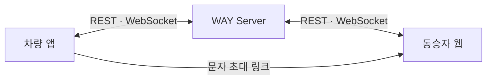

# WAY Server

WAY는 운전자와 동승자가 같은 장소 이름을 듣고도 도로 반대편에서 기다리거나 서로의 도착 시간을 몰라 엇갈리는 문제를 줄이기 위해 만든 현대자동차그룹 차량용 앱 개발 공모전 프로젝트입니다. 운전자가 지도에 찍은 픽업 지점과 차량 도착 예정 시간(ETA)을 동승자의 휴대전화에서 확인할 수 있도록 공유합니다.

WAY Server는 차량 앱과 동승자 웹이 같은 픽업의 상태를 공유하도록 설계한 Spring Boot 서버입니다. 현재 `main`에는 애플리케이션 진입점과 컨텍스트 로딩 테스트가 있으며, 아래 픽업 흐름은 가상 픽업 연동을 위한 MVP 설계입니다.

## 픽업 시나리오

1. **픽업 지정** — 운전자가 차량 앱의 지도에서 만날 지점을 찍고, 동승자에게 초대 링크를 문자로 보냅니다.
2. **픽업 참여** — 동승자가 링크를 열어 앱 설치 없이 웹에서 픽업 지점, 차량 위치, 도착 예정 시간을 확인합니다.
3. **정차 대기** — 차량이 먼저 도착하면 두 화면에 같은 기준의 대기 타이머가 표시됩니다.
4. **탑승 완료** — 두 사람이 만나 탑승하면 픽업을 마치고 위치 공유를 종료합니다.

제출용 시연은 mock 데이터로 계획했습니다. 팀 Figma 시안을 보려면 열람 권한이 필요할 수 있습니다. [차량 앱 주행 시안](https://www.figma.com/design/j5zq5vqwmk1hNacooTxfmB/WAY?node-id=73-366) · [동승자 웹 대기 시안](https://www.figma.com/design/j5zq5vqwmk1hNacooTxfmB/WAY?node-id=73-1112)

## 서버 구조



MVP에서 서버는 픽업 생성과 초대 링크 발급, 차량·동승자 권한 확인을 맡습니다. 각 화면은 REST로 현재 픽업 상태를 조회하고, WebSocket으로 위치·ETA·상태 변경을 받도록 설계했습니다.

**서버 담당 · 재원 (`jwon0523`)** — 픽업 API 계약과 공통 대기 흐름을 설계했습니다. 상세 API와 설계 범위는 서버 맥락 문서에서 확인할 수 있습니다. [WAY 서버 맥락](docs/project-context.md)

## 기술 스택과 실행

- Java 21, Spring Boot 4.1.2, Gradle Wrapper
- REST API와 실시간 갱신을 위한 Spring MVC, WebSocket 의존성
- 데이터 저장과 스키마 관리를 위한 Spring Data JPA, MySQL, Flyway 의존성

로컬 실행과 컨텍스트 로딩 테스트에는 JDK 21과 접속 가능한 MySQL이 필요합니다. 실행 환경에서 `SPRING_DATASOURCE_URL`, `SPRING_DATASOURCE_USERNAME`, `SPRING_DATASOURCE_PASSWORD`를 설정하고 저장소 루트에서 아래 명령을 사용합니다.

```bash
./gradlew bootRun
./gradlew test
```

실행 절차는 저장소 설정을 기준으로 정리했으며, MySQL을 연결한 구동과 테스트는 확인이 필요합니다.
