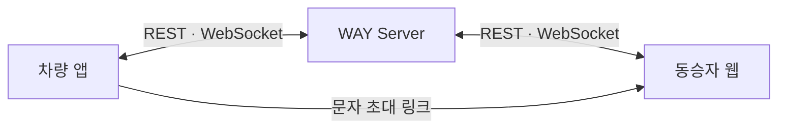

# WAY Server

WAY는 운전자와 동승자가 같은 장소 이름을 듣고도 도로 반대편에서 기다리거나 서로의 도착 시간을 몰라 엇갈리는 문제를 줄이기 위해 만든 현대자동차그룹 차량용 앱 개발 공모전 프로젝트입니다. 운전자가 지도에 찍은 픽업 지점과 차량 도착 예정 시간(ETA)을 동승자의 휴대전화에서 확인할 수 있도록 공유합니다.

WAY Server는 차량 앱과 동승자 웹이 같은 픽업의 상태를 공유하도록 설계한 Spring Boot 서버입니다. 현재 `main`에는 애플리케이션 진입점과 컨텍스트 로딩 테스트가 있으며, 아래 픽업 흐름은 가상 픽업 연동을 위한 MVP 설계입니다.

## 픽업 시나리오

1. **픽업 지정** — 운전자가 차량 앱의 지도에서 만날 지점을 찍고, 동승자에게 초대 링크를 문자로 보냅니다.
2. **픽업 참여** — 동승자가 링크를 열어 앱 설치 없이 웹에서 픽업 지점, 차량 위치, 도착 예정 시간을 확인합니다.
3. **정차 대기** — 차량이 먼저 도착하면 두 화면에 같은 기준의 대기 타이머가 표시됩니다.
4. **탑승 완료** — 두 사람이 만나 탑승하면 픽업을 마치고 위치 공유를 종료합니다.

제출용 시연은 mock 데이터로 계획했습니다. 팀 Figma 시안을 보려면 열람 권한이 필요할 수 있습니다. [차량 앱 주행 시안](https://www.figma.com/design/j5zq5vqwmk1hNacooTxfmB/WAY?node-id=73-366) · [동승자 웹 대기 시안](https://www.figma.com/design/j5zq5vqwmk1hNacooTxfmB/WAY?node-id=73-1112)

## 서버 구조



MVP에서 서버는 픽업 생성과 초대 링크 발급, 차량·동승자 권한 확인을 맡습니다. 각 화면은 REST로 현재 픽업 상태를 조회하고, WebSocket으로 위치·ETA·상태 변경을 받도록 설계했습니다.

**서버 담당 · 재원 (`jwon0523`)** — 픽업 API 계약과 공통 대기 흐름을 설계했습니다. 상세 API와 설계 범위는 서버 맥락 문서에서 확인할 수 있습니다. [WAY 서버 맥락](docs/project-context.md)

## 기술 스택과 실행

- Java 21, Spring Boot 4.1.2, Gradle Wrapper
- REST API와 실시간 갱신을 위한 Spring MVC, WebSocket 의존성
- 데이터 저장을 위한 Spring Data JPA와 MySQL

### MySQL 기동

로컬 실행에는 JDK 21과 Docker Compose가 필요합니다. MySQL을 띄우기 전에 Docker를 실행합니다. 처음 실행할 때 저장소 루트에서 [`.env.example`](.env.example)을 `.env.local`로 복사하고, DB 이름과 앱 계정, 앱 비밀번호, root 비밀번호를 채웁니다. `MYSQL_PORT`를 비워두면 호스트 포트는 `3306`입니다.

```bash
cp -n .env.example .env.local
```

[`compose.local.yaml`](compose.local.yaml)로 MySQL을 띄웁니다. `--wait`는 앱 계정으로 DB에 접속하는 healthcheck가 성공할 때까지 기다립니다.

```bash
docker compose --env-file .env.local -f compose.local.yaml up --wait
```

### Spring 연결

IntelliJ에서 `WayApplication`의 실행 설정을 열어 **Active profiles**에 `local`을 입력하고 **Environment variables**에 `.env.local` 파일을 지정합니다. [`application-local.yaml`](src/main/resources/application-local.yaml)이 `MYSQL_PORT`, `MYSQL_DATABASE`, `MYSQL_USER`, `MYSQL_PASSWORD`로 접속 설정을 구성합니다. Compose에서 기본 포트를 사용했다면 `.env.local`의 `MYSQL_PORT`를 `3306`으로 설정합니다.

터미널에서 실행할 때는 아래 환경변수의 `<...>`를 `.env.local`의 값으로 바꿉니다.

```bash
export SPRING_DATASOURCE_URL='jdbc:mysql://127.0.0.1:<MYSQL_PORT>/<MYSQL_DATABASE>'
export SPRING_DATASOURCE_USERNAME='<MYSQL_USER>'
export SPRING_DATASOURCE_PASSWORD='<MYSQL_PASSWORD>'
SPRING_PROFILES_ACTIVE=local ./gradlew bootRun
```

`local` 프로필로 기동하면 테스트 차량 `DEMO-VIN-001`이 자동 등록됩니다. 픽업 API를 호출할 때 `VIN: DEMO-VIN-001` 헤더를 보냅니다.

초대 링크에 사용할 동승자 웹 주소는 `WAY_PICKUP_INVITATION_WEB_BASE_URL`로 지정합니다. `local` 프로필의 기본값은 `http://localhost:3000`이며 시연 서버에서는 동승자 웹의 HTTPS 주소를 설정합니다.

IntelliJ에서 `local` 프로필로 Docker MySQL에 연결해 서버가 기동하는 것을 확인했습니다. 컨텍스트 로딩 테스트는 MySQL이 실행 중인 상태에서 위 `SPRING_DATASOURCE_*` 환경변수로 `./gradlew test`를 실행합니다.

### MySQL 볼륨

`local` 프로필의 `ddl-auto: create-drop`은 Hibernate가 관리하는 테이블을 서버 시작 시 재생성하고 종료 시 삭제합니다. 해당 테이블을 유지하려면 실행 설정에서 `SPRING_JPA_HIBERNATE_DDL_AUTO=none`으로 덮어씁니다.

`mysql-data` 볼륨에 DB가 저장되므로 `docker compose --env-file .env.local -f compose.local.yaml down`으로 컨테이너를 내려도 데이터는 남습니다. DB 이름과 계정, 비밀번호는 빈 볼륨을 처음 초기화할 때 적용됩니다. 기존 볼륨이 있으면 `.env.local`에서 값을 바꿔도 DB와 계정은 그대로라 healthcheck나 Spring 연결이 실패할 수 있습니다. `down --volumes`를 사용하면 볼륨과 그 안의 데이터가 삭제됩니다.
